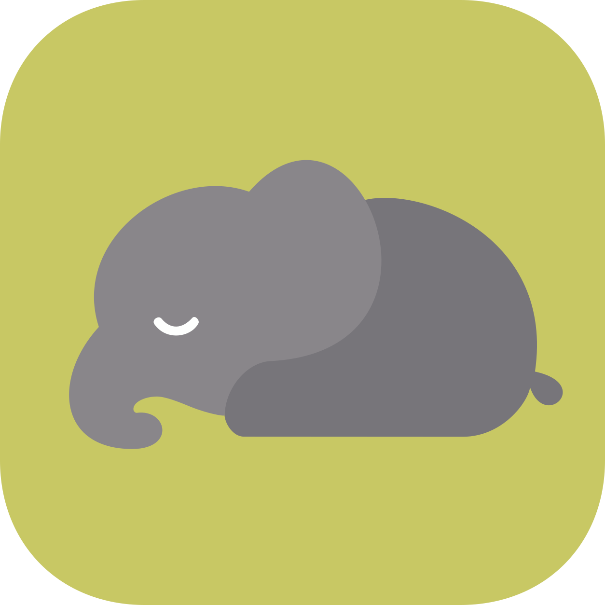

<p align="center"></p>

<h1 align="center">EleSim</h1>

<p align="center">https://doi.org/10.1109/LRA.2026.3663818</p>

<br>

## 1. How to Start

### 🧙 Setup Wizard

Run the following command.

   ```bash
   curl -fsSL https://raw.githubusercontent.com/jpyaaa3/elesim/main/installer/install.sh | bash
   ```

### 🐳 Tailscale with Docker Desktop

While using Docker Desktop, you need to generate a emulated Tailscale IP for DDS communication.

   ```bash
   ./elesim tailscale login
   ```

### 🐘 Connection Manager

Run `./elesim connections` to configure your system ID and launch EleSim for the first time or after changing your environment.

For future sessions, simply use `./elesim up <system-id>` to start it.

   ```bash
   ./elesim connections
   ```

<br>

## 2. Apps and Commands

### 💻 Applications

| Name | Role |
| --- | --- |
| Pilot | Calculator |
| UI | Control Panel |
| Sim | Simulation on [Genesis World](https://github.com/Genesis-Embodied-AI/genesis-world) |
| Robot | On-board Software for Jetson |

UI는 기본적으로 작업 조작과 카메라를 한 창에 표시한다. 왼쪽의 `Scan / Manual /
Legacy / Status` 탭에서 작업을 선택하며, 기존 HSV·YOLO·UV/LJI 조작은 `Legacy`에
있다. 오른쪽 영상의 `Layout`으로 관찰 화면·핸드아이 확대·나란히 보기를 선택한다.
Robot 카메라는 좌우 함께 또는 한쪽을 크게 볼 수 있다. 창 가장자리와 두 영역
사이 경계를 끌어 크기를 조절하고, `Controls`를 끄면 영상이 전체 영역을 쓴다.
별도 모니터에서는 `Pop out`으로 카메라를 분리하고 `Dock` 또는 창 닫기로 복귀한다.
상단 제어 대상과 영상의 `View` 선택은 서로 독립이다.

소스 저장소 루트에서 화면 배치만 직접 조작하려면 다음 Mock UI를 실행한다.
UI·OpenCV 의존성과 데스크톱 디스플레이가 있는 Python 환경이 필요하다.
실제 역할 프로세스에 연결하지 않으며 영상과 상태는 로컬 예시다.

```bash
python3 -m workbench.tools.ui_preview --interactive
```

DDS is used by default, while video is sent via WebRTC.

Control Target and Camera View are independent. When Robot is present, Sim
mirrors its measured state and Pilot retains the Robot target across connection
loss. The default linear calibration is **1.5°/mm, max 260° (173.333 mm)**.


### ⌨️ Commands

```bash
./elesim connections         # Manage topology and system registrations
./elesim list                # Show all registered systems

./elesim up <system-id>      # Start a registered system
./elesim down <system-id>    # Stop a registered system
./elesim logs <system-id>    # Check its logs
./elesim remove <system-id>  # Remove the system registration

./elesim tailscale login     # Log in to the Docker Desktop Tailscale sidecar
./elesim tailscale status    # Show sanitized Tailscale status

./elesim update              # Update/build/publish EleSim
./elesim uninstall           # Remove EleSim
```

<br>

## 3. Documents

[Setup](docs/setup.md)  
[Deployment](docs/deployment.md)  
[Configuration](docs/configuration.md)  
[Architecture](docs/architecture.md)  
[DDS Contracts](docs/dds_contracts.md)  
[Dev Status](docs/status.md)  
[Research](docs/research.md)

[외부 모델 연결 계약과 실행 예제](docs/model_integration.md)


## RL training example

[Two-band cylinder hugging](workbench/research/experiments/hug_interpolation/README.md)
shows how to define an external task on EleSim's common RL APIs, train six local
anchors, collect trajectories, and evaluate interpolation without additional RL.
A small real-map input is included; the full Hugmap table is not required.
See the example for prerequisites and the current validation boundary.
