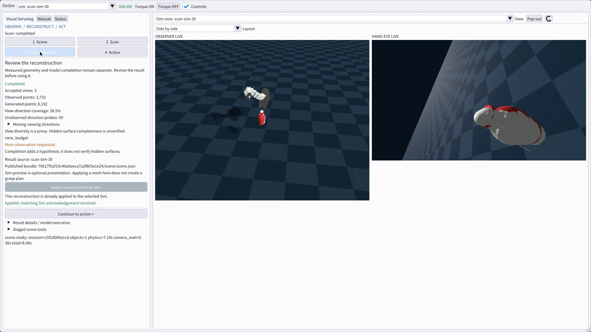
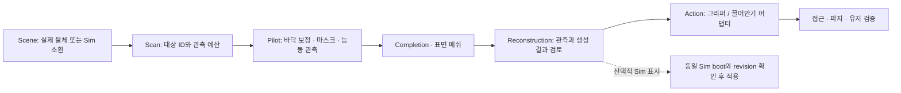

# Visual Servoing 작업 화면

`Visual Servoing` 하나에서 장면을 준비하고 관측·재구성 결과와 동작을 다룬다.
`Manual`은 하드웨어/4-DOF/GO2/IK, `Status`는 상세 진단/IMU/바닥 보정/배율이다.
종전 Scan·Legacy 탭과 Manual의 Mock Object·Wrap 행은 제거했다.



[실제 전체 창 데모: 97초, 1920×1080, 30 fps](../workbench/evidence/curated/ui/visual_servoing_poisson_demo_20261101.mp4).
GPU2의 실제 DDS/WebRTC/Genesis와 Pilot 모델을 사용해 OS 입력으로 조작했다.
[실행 조건과 검증 범위](../workbench/evidence/curated/ui/visual_servoing_poisson_20261101.json).
위 영상·화면은 레이아웃 정리 전 촬영본이다. 현재 Sim 영상은 observer 메인과
우측 상단 hand-eye 서브 화면으로 고정하며 레이아웃 선택 메뉴는 없다.



Action의 메쉬 기반 실행과 유지 검증은 아직 연결되지 않은 단계다. 현재 화면은
이 부분을 비활성으로 표시하며 완료를 꾸며내지 않는다. Sim 표시 분기는 파지 계획을
생성하거나 Robot motion authority를 만들지 않는다.

## 조작 순서

1. 위쪽 Control Target과 Camera View를 확인한다. 둘은 독립이다. 같은 창 안에서
   observer 메인과 우측 상단 hand-eye 보조 화면을 함께 본다.
2. Scene에서 실제 물체를 준비하거나 live Sim catalog의 물체를 배치한다.
   위치(m)/회전(deg)은 Placement에 있다. 소환·제거·분리는 UI Sim session 권한을
   쓰며 Pilot의 motion lease를 대신하지 않는다.
3. Scan에서 출력 instance ID와 view budget을 정하고 명시적으로 시작한다.
   현재 detector adapter는 단일 객체 마스크를 고른다. ID 입력은 instance 선택이나
   다중 객체 segmentation UI가 아니다. 모델 프로필은 Pilot 설정을 따른다.
   이전 UI의 YOLO/HSV 버튼으로 새 scan 프로필이 바뀌는 것처럼 표시하지 않는다.
   현재 integrated 기본 프로필은 촬영별 FloorTilt → 실제 AdaPoinTr AP-PS55 →
   Poisson 표면 적합과 4 mm remesh다. 이미 설치된 옛 image의 프로필은 별도이므로
   Result details의 실제 model execution도 확인한다.
4. Pilot이 관측·바닥 보정·view 선택·completion·meshing을 수행한다. 진행 단계,
   accepted views, observed/generated points, 방향 coverage와 중단/실패 사유를 본다.
   Coverage는 시선 다양성의 proxy이며 100%여도 숨은 면을 확인했다는 뜻이 아니다.
5. Reconstruction에서 결과를 검토한다. 동일 Sim이 생산한 published bundle만
   `Apply reconstruction to Sim`으로 적용한다. matching ACK가 와야 Applied로
   표시한다. 중복 적용, 다른 boot의 결과, 누락된 revision은 차단한다.
   상세 model execution과 수동 staged bundle 입력은 접힌 도구에 있다.
6. Action에서 그리퍼/끌어안기 전략의 연결 상태를 확인한다. 기존 시험을 쓰려면
   접힌 reference Hug 또는 configured pole policy bench를 명시적으로 연다.

## 현재 연결 범위

| 화면 기능 | 실제 경로 / 제한 |
| --- | --- |
| Sim object 배치·제거·분리 | 기존 UI Sim-session command와 catalog |
| 스캔 시작·취소 | 기존 Pilot live scan; **현재 Sim 전용** |
| 바닥 보정·segmentation·completion·mesh | Pilot에 설정된 model API v1 adapters; 실패는 live status로 표시 |
| 재구성 Sim 적용 | producer Sim ID/boot + published revision 검증, request ACK 확인 |
| 메쉬 기반 gripper/embrace | 실행 어댑터 미연결, 비활성 |
| Reference Hug | Sim ground truth 단면 + open-space 보간, 카메라 재구성 입력 아님 |
| Configured pole Wrap | Pilot 설정의 원통 geometry와 학습 정책; 임의 메쉬 입력 아님 |
| 파지 유지 검증 | 미연결; 명령 완료/Sim attachment를 물리 파지 성공으로 표시하지 않음 |

모델 공급자는 [model API와 integration 경로](model_integration.md)를 따른다.
UI가 모델을 로드하거나 Pilot workflow를 import하지 않는다. 이번 변경은 wire
메시지나 버전을 추가하지 않고 DDS v6/operator-view v1을 유지한다. 기존 detector,
UV/LJI 계산과 wire API는 공유 backend/호환 경로로 남는다. 종전 UI 폼과 자동
Walk+Grasp 진입점을 되살리지 않는다.

## 진행 중 조작과 결과 수명

단계 이동은 화면만 바꾼다. 렌더링·완료 callback이 다음 동작을 자동 시작하지 않는다.
스캔 또는 경쟁 motion 중에는 장면 변경과 다른 시작을 막는다. Pilot의 preflight와
동작 소유권 검사는 그대로 유지한다. 취소는 stale/offline 표시에서도 제출할 수 있다.

상단 `Stop workflow`는 스캔/trajectory/pick/wrap/gaze에 기존 중지 intent를 보낸다.
Reference Hug는 Sim pause로 멈추므로 재개는 명시적으로 한다. 기존 IK solve에는
cancel adapter가 없어 해당 작업의 Stop은 torque-off를 요청한다. Solver의 계산
중단이나 실기기 stop deadline을 증명하는 기능은 아니다. `Torque OFF`도 계속 노출한다.
Wrap은 기존 Pick stop event를 읽고 ramp 중간 및 roll 명령 전에도 취소를 확인한다.
Sim이 paused인 경우 단계 이동 영역에 `Resume Sim`을 표시한다. Hug 중지나 scene
재빌드 실패 뒤에도 여기서 명시적으로 재개한다. Pilot이 offline이어도 live UI Sim
session 권한으로 재개할 수 있으며, ACK를 받기 전에는 다시 제출하지 않는다.

Reference solution은 control endpoint/boot, UI Sim/boot/session, epoch와 mock
revision/digest가 바뀌면 폐기한다. 늦게 온 callback과 timeout된 요청의 결과는
새 작업을 덮어쓰지 못한다. Sim scene 적용 표시는 reset·다른 scene 로드/제거·새
재구성 결과에서 무효화된다. 실패는 성공으로 표시하지 않으며 다시 시도할 수 있다.
새 Scan/Wrap 시작은 이전 reference solution을 폐기한다. Pilot 요청의 응답은
control endpoint/boot에, scene command의 ACK는 UI Sim/boot/session에 묶는다.
카메라만 바꾸거나 조작 대상만 바꿨다는 이유로 서로 다른 소유자의 유효한 응답을
버리지 않는다. Reference Hug는 두 경로를 모두 사용하므로 양쪽 일치를 요구한다.

## Mock 실행

저장소 루트에서:

```bash
python3 -m workbench.tools.ui_preview --interactive --scenario reconstructed
```

`--scenario offline|ready|scanning|reconstructed|failed|robot|paused`과
`--stage scene|scan|reconstruction|action`으로 상태와 단계를 지정한다.
`--tab Manual` 또는 `--tab Status`도 가능하다. PNG 출력 예:

```bash
python3 -m workbench.tools.ui_preview --output workbench/evidence/generated/servoing.png --scenario reconstructed --width 1920 --height 1080
```

실제 production UI를 로컬 fixture로 그리며 `MOCK`으로 표시한다. 버튼 요청은
로컬에서 거부되고 DDS/모델/Robot/Genesis를 시작하지 않는다. 기존 PNG는 덮어쓰지
않는다. 이 도구는 실행 중 인스턴스를 업데이트하거나 재시작하지 않는다.
[Mock 예시 PNG](../workbench/evidence/curated/ui/visual_servoing_20261101.png)는 위 실제
실행의 영상·화면과 별도 자료다.
